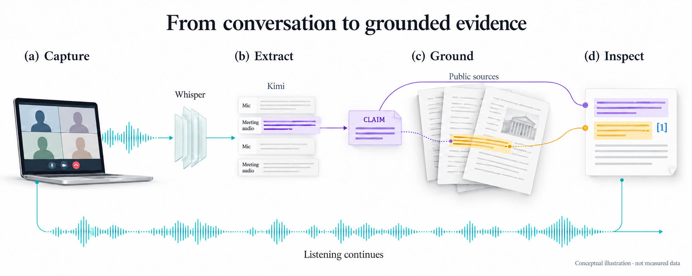

# Grounded

**Fact-check important meeting claims without stopping the conversation.**

Join Google Meet, open its detected room in Grounded, and speak normally. Grounded
shows the live transcript beside compact cards containing **the claim, a direct
finding, and inspectable evidence**. End the meeting and reopen the same script,
cards and sources later from **Past meetings**.

**Version 0.7.2 · macOS Apple Silicon.** [Run locally](docs/RUNNING.md) ·
[Architecture](docs/SYSTEM_GUIDE.md) · [Evaluation](docs/VALIDATION.md)

> **Example:** “SQLite WAL works across servers on a network filesystem.”
> Grounded extracts that claim, retrieves documentation, and presents a finding
> linked to the original utterance and an exact source quotation. This is evidence
> assistance, not a guarantee that every statement or interpretation is correct.

## Understand it in one minute

Conceptual illustration, not a runtime screenshot: capture continues while checks
run asynchronously. Input labels identify channels, not individual speakers.
Explore the [visual atlas](docs/VISUAL_ATLAS.md) for mechanisms and measured timings.

| Part | What it does | Where it runs |
| --- | --- | --- |
| Desktop app | Detects Meet; captures authorized audio; renders script/cards | Participant's Mac |
| FastAPI service | Owns sessions, queues, validation, credentials and saved history | Same Mac or SSH-connected server Mac |
| **Custom Runpod endpoint** | **Whisper large-v3 CUDA transcription** using our handler, container and pinned model | Runpod Serverless GPU |
| Runpod public Kimi K3 | Extracts factual claims and synthesizes findings with strict schemas | Managed Runpod public endpoint |
| Firecrawl | Searches and reads public source pages | External search service |

**The self-deployed endpoint is Whisper.** Kimi is a managed public
endpoint, not a second model we self-host. Recall's SDK is used for meeting detection
only; no meeting bot or Recall recording/upload API is used.

## Read only what you need

- **Understand the design:** [System guide](docs/SYSTEM_GUIDE.md) — one sentence through the pipeline, data model, concurrency and failure recovery.
- **Run or reproduce it:** [Setup and operations](docs/RUNNING.md) — separate terminals, private credentials, deployment, warmup and tests.
- **Assess the evidence:** [Current validation](docs/VALIDATION.md) — synthetic versus native tests, measured latency, remaining limits.
- **Review the implementation:** [Code guide](docs/REVIEW_GUIDE.md) — entry points, contracts and evidence.
- **Find deeper details:** [Documentation index](docs/README.md).

## Engineering highlights

- Audio capture continues while independent checks run in the background.
- Encrypted, quota-bounded local audio retention decouples capture from slow transcription;
  chunks are removed only after a committed terminal outcome, not upload success.
- Transcript effects and audio receipts commit atomically; stable identities make
  lost-acknowledgement retries idempotent without claiming exactly-once GPU execution.
- Session **epochs** reject old audio; claim **revisions** reject stale research results.
- Repeated claims attach to one card instead of triggering duplicate research.
- The model chooses server-owned quote IDs; unknown sources and fabricated quotes are rejected.
- Search failure and **insufficient evidence** are distinct from a false claim.
- Normalized SQLite records preserve script, claim revisions, findings, source navigation and viewing state across restart.
- End closes capture but drains accepted work; explicit restart recovery never silently
  reopens a microphone or authorizes new paid processing.
- Content-free, bounded diagnostic logs correlate processing stages without logging conversations.
- Measured design changes address observed failures: dense-claim extraction, fetched
  error pages, and End requests arriving during asynchronous capture startup.

These are implementation contracts, not a claim of lossless recognition or certified
production reliability. [Validation](docs/VALIDATION.md) separates deterministic
failure-injection tests, model evaluations and packaged-device acceptance.

## Scope, privacy and limits

English only; one active meeting; Apple Silicon macOS 14.2+ and Chrome. Obtain
participant authorization and use headphones. System playback can include other
applications; input-channel labels are **not named-speaker identification**.

Pending audio is retained encrypted on the participant Mac until a durable transcription
outcome is confirmed. Failed audio remains for explicit recovery or deletion; capture
does not silently resume after restart. See [audio recovery](docs/DURABLE_AUDIO.md)
and the [relational schema](docs/HISTORY_SCHEMA.md).
Transcripts, findings and short quotations
remain in private SQLite on the connected server; returning to the list does not
delete them. Provider retention policies still apply. No shared web URL, multi-user
authentication, public API exposure or notarized app distribution is included.

The GPU speech endpoint needs explicit prewarming. Kimi latency varies; neither
instant results nor perfect ASR/factual accuracy is promised. Very short cut-off
audio can still be misrecognized. See [current validation](docs/VALIDATION.md).

New meetings use a persisted [capacity policy](docs/CAPACITY_POLICY.md): at most
768 transcript segments, one hour of capture, 180 extraction calls and 60 research
attempts. These are bounded workload/resource limits, not a guarantee of an hour
of arbitrary speech. AI budget exhaustion does not stop transcription. Two research
jobs may run concurrently, with three attempts per card. Legacy meetings retain
their original limits rather than silently resetting budgets on recovery.

[Design experiments](docs/DESIGN_EXPERIMENTS.md) explain which changes the evidence
supports, which settings were retained, and why experimental improvements were not
automatically promoted. [Capture state ownership](docs/CAPTURE_STATE.md) describes
explicit start/pause/end transitions and late-startup protection.

The application bundle is named `Roomshift Research.app`; configuration lives under
`~/.config/roomshift/`. The product name shown in the interface is Grounded.
