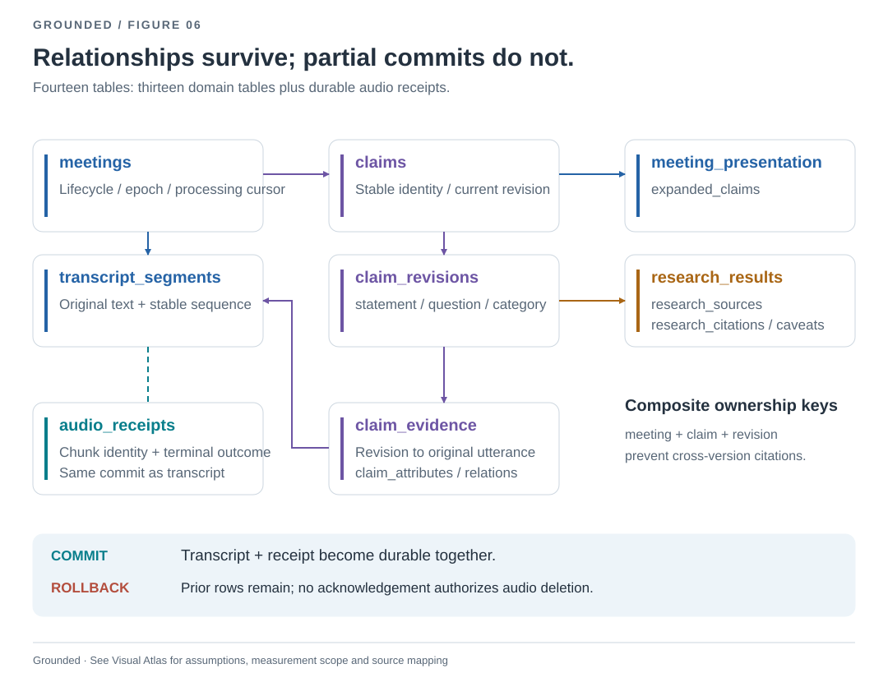
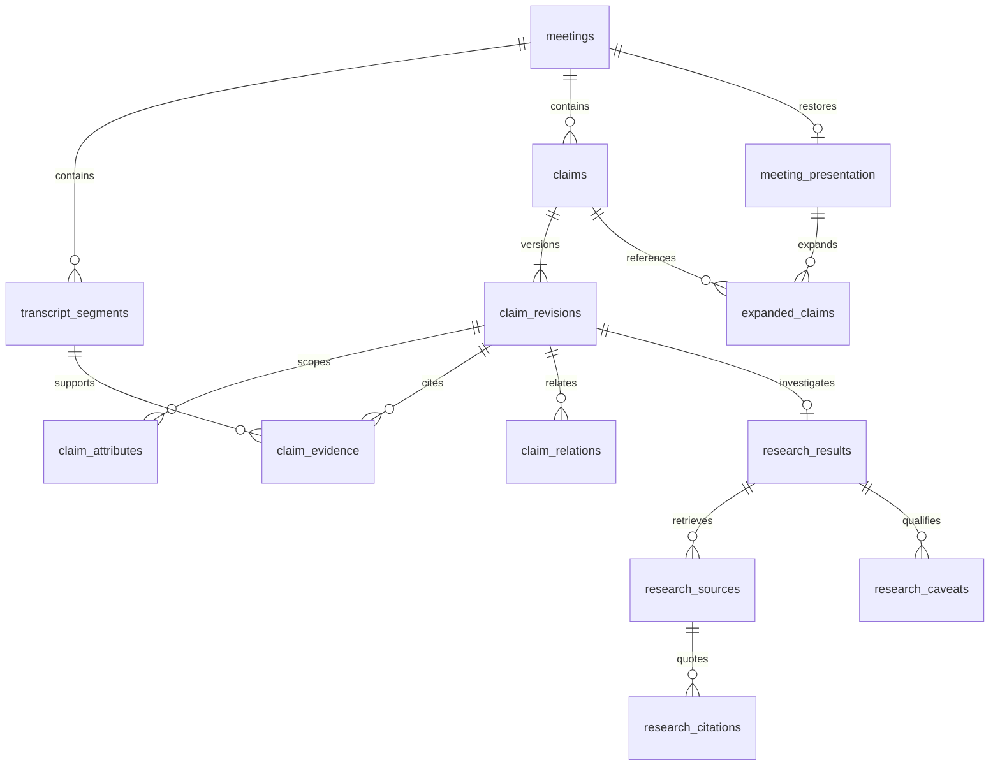

# Relational meeting history

Grounded stores durable domain entities in typed SQLite `STRICT` tables. It does
not store a meeting document in a `payload` column, and the meeting list does not
depend on a second, potentially stale summary document. The HTTP response remains
a nested DTO for UI compatibility; that response shape is not the storage schema.

## Entity relationships

The thirteen domain tables below are accompanied by `audio_receipts`, keyed by
meeting, epoch, input source and sequence. Its content digest binds retries to
the original audio. Transcript outcomes and terminal receipts commit together;
only then may the desktop remove its encrypted chunk. See
[the receipt protocol](DURABLE_AUDIO.md) for pending, failed and completed states.

| Table | Identity / important fields | Responsibility |
| --- | --- | --- |
| `meetings` | `id`; title, creation/end/update times, state, epoch, consent versions, finalization state/message | Session lifecycle and ownership |
| `transcript_segments` | `(meeting_id, id)`; position, source, text, timestamps, echo reference | Ordered, immutable accepted utterances |
| `claims` | `(meeting_id, id)`; position, current revision, edited flag, attempt count | Stable card identity and pointer to its current version |
| `claim_revisions` | `(meeting_id, claim_id, revision)`; statement, question, category, state, research signature, reason | Retains each observed substantive version |
| `claim_attributes` | revision + kind + position; value | Ordered conditions and missing-information items |
| `claim_evidence` | revision + segment ID; evidence ordering | Connects a version to original utterances without duplicating their text |
| `claim_relations` | revision + position; related claim ID | Same-meeting relationships to other claims |
| `research_results` | claim revision; state, verdict, summary, recommendation, query, completion time | One research lifecycle per revision |
| `research_sources` | claim revision + source ID; URL, title, retrieval time, hash, excerpt size, kind | Source metadata as retrieved for that investigation |
| `research_citations` | claim revision + position; source ID, exact quote | Ordered quotations linked to the correct source snapshot |
| `research_caveats` | claim revision + position; value | Ordered limitations on the conclusion |
| `meeting_presentation` | meeting ID; two scroll positions | Viewing state, separate from research content |
| `expanded_claims` | meeting ID + claim ID; position | Expanded cards referencing real cards in that meeting |

`S1` is only unique inside a particular claim revision. It must never resolve to
another meeting's `S1`, or even another revision's `S1`. Composite foreign keys
enforce these ownership boundaries for evidence, related claims, sources, citations,
and presentation. Claims point to an existing revision using a deferred foreign key;
both records are created atomically. Every connection enables `foreign_keys=ON`.

## What is immutable, and what changes?

- Transcript identity, order, text and captured metadata cannot be rewritten by a
  later checkpoint. Claim evidence joins to these original rows.
- A substantive change must increment the research revision. Saving different
  statement/category/question/state/conditions under an existing revision fails.
  Earlier revisions and their findings/sources/citations remain in the database.
  A model correction updates the verification question while retaining the card ID
  and topic key. Repeated evidence links do not rewrite the question; an explicitly
  user-edited question remains protected from model replacement.
- Repeating an unchanged claim may update the evidence links and explanatory reason
  of its current revision without inventing a new research version. The active
  bounded evidence list is not an append-only audit of every repeated utterance.
- A research lifecycle updates from pending to completed within a revision. Current
  retries increment the revision in the service. This schema does not claim a
  separate historical record for every intermediate progress callback.
- Legacy records contain only their latest revision. Migration inserts that known
  revision; it does not fabricate versions 1 through N or recover lost sources.

The existing API opens the latest revision. Preserved prior versions are currently
available to SQL diagnostics, not a new revision-history screen or public API.

## JSON is not a domain storage escape hatch

Operational state remains in `meetings.runtime_json`: per-input sequence and
word-boundary counters, the detector's processed-transcript cursor and status,
research request budgets, and queue depths. These include recovery-critical
checkpoints, not merely diagnostics. The extraction cursor is committed in the
same transaction as its claim changes; recovery restores these values explicitly.
Provider token/timing telemetry is stored separately in research telemetry JSON.
These JSON fields are not transcript text, claims, findings,
source documents, or citations. Unknown domain fields fail validation; they are not
silently hidden in an `extras` blob. Consent and lifecycle fields are explicit columns.

Nullable field-presence bitmasks retain the distinction between absent fields and
explicit nulls in legacy/partial DTOs. They contain no domain values. Collection
presence masks similarly preserve absent versus empty lists. Application code
never interprets these as a new business state.

## Queries and writes

The list query reads typed meeting columns and indexed child counts. It does not
read all transcripts to render a page, and there is no duplicate summary to update.
The `(created_at DESC, id DESC)` index supports deterministic pagination. Child
primary keys and order indexes support meeting-scoped reads; reverse evidence and
citation-source indexes support integrity and investigation.

The DTO adapter compares/upserts rows using `ON CONFLICT ... DO UPDATE ... WHERE`
with null-safe value comparisons. Identical saves produce zero row writes. A scroll
change updates presentation and the meeting timestamp, not transcripts or findings.
Child collections delete only removed identities and upsert changed identities.
Checkpoints do not delete/reinsert a whole meeting graph. Existing claims or segments
cannot silently disappear from a checkpoint.

One SQLite transaction contains the entire checkpoint. Any error, including a
deferred foreign-key failure at commit, rolls back the complete update. The prior
committed meeting remains readable. The service retains its unsaved memory and
existing save-warning/detach protection. `synchronous=FULL` and mode 600 remain.

The service still supplies a whole in-memory DTO to the adapter. This keeps the
integration small, but saves do read/compare the bounded graph; it is not a new
unbounded event-store or distributed write service. If scale requires it, explicit
entity commands can replace the adapter without changing the normalized schema.

## Migration and deployment

Schema version 0 is the old `meetings(id, created_at, updated_at, payload, summary)`
table. Version 1 is this normalized schema, recorded in `PRAGMA user_version`.

Migration runs under `BEGIN IMMEDIATE`: rename the legacy table, create the schema,
validate/map every legacy payload, preserve original identity and timestamps,
run `foreign_key_check`, drop the legacy table, and advance the schema version.
DDL, data, index changes and version update commit together. A malformed or
unrecognized domain field aborts the entire migration, leaving version 0 intact.
The obsolete summary is recomputed from authoritative normalized fields and counts.
Opening version 1 is idempotent; unsupported future versions fail closed.

Deployment must be coordinated with the runtime owner:

1. Finish or explicitly preserve the current session; stop the old backend.
2. Take a private SQLite backup using the backup API (include committed WAL state).
3. Migrate a backup copy first; compare reconstructed data and inspect
   `PRAGMA foreign_key_check` and `PRAGMA integrity_check` without printing transcripts.
4. Start the new backend with the production database only after successful checks.
5. Verify listing, reopening, source links and finalization. Keep the private backup.

Never migrate a live database under an older process that still writes payloads.
Rollback is a coordinated restore of the private version-0 backup with the old
backend; there is no lossy automatic downgrade from new relational history.

## Validation and limits

Deterministic tests exercise exact current DTO round trips, retained old revisions,
same source IDs across revisions, foreign-key rejection of cross-meeting evidence,
invalid citations, atomic rollback, unknown fields, non-finite values, zero-write
no-ops, presentation-only write isolation, and one-query lightweight listing.
Migration tests cover version-0 conversion, latest-only legacy revisions,
repeat opening, unknown fields after a valid row, broken relationships, and rollback
of both DDL and migrated data. Existing API/restart/finalization tests still apply.

A copy of a saved synthetic-meeting database migrated successfully
(one meeting, zero foreign-key violations); the original was not modified.
This is compatibility evidence for that saved fixture, not proof that every possible
historical corruption can be repaired. Unknown shapes intentionally stop migration.

This SQLite repository stores no raw audio; encrypted pending audio is retained
separately on the participant device. Full retrieved page bodies are transient;
durable source metadata and exact selected quotations are retained. The current
research DTO does not return model quote-option IDs, so migration cannot invent
them; durable citations use ordered IDs and their exact source/quote relationship.
This database is not encrypted at rest and has no multi-tenant account model.
Interrupted processing requires explicit recovery rather than automatic replay.

Implementation: [schema](../server/history_schema.py),
[relational mapping](../server/history_store.py),
[migration and repository](../server/meeting_history.py),
[regression tests](../tests/test_history_relational.py).
