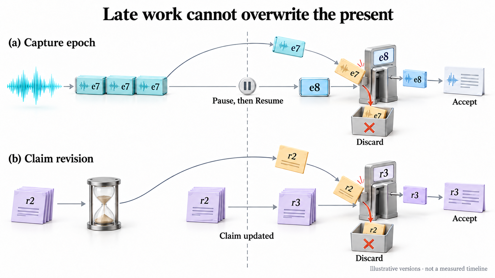

# Research pipeline and failure boundaries

Conceptual illustration, not a timing measurement. Fresh audio starts only after
Resume. Publishing also checks session identity, capturing or finishing state and candidate
state; matching the illustrated version alone is not sufficient.

## Scope

One English meeting, one trusted operator, localhost/SSH transport. No meeting bot,
named-speaker inference, camera effects or automatic actions on third-party websites.
The application continuously captures authorized audio after Start. UI focus and
minimization do not intentionally stop the audio graph.

```mermaid
flowchart LR
  A[Microphone AudioWorklet + native system audio] --> B[Chunker / bounded upload queue]
  B --> C[Runpod Whisper large-v3]
  C --> D[Timestamped transcript in memory]
  D --> E[Runpod Public Kimi K3: premise extraction]
  E --> F[Versioned research cards]
  F --> G[Queue: 8 waiting / 2 workers]
  G --> H[Firecrawl: search + read up to 3 documents]
  H --> I[Kimi K3: evidence-based finding]
  I --> J[Schema + citation + exact-quote validation]
  J --> F
```

## Boundaries

- Audio and text processing are independent. A research failure cannot silently
  turn into a transcription failure or a factual verdict.
- K3 uses a public API with low reasoning effort and bounded output. Its hardware
  is not selected by this application. Whisper runs on the dedicated GPU endpoint.
- Search receives only a verification question, not the complete meeting script.
  Kimi receives selected public excerpts and the original claim context.
- Source documents are untrusted data. No model output can execute a command,
  fetch an arbitrary local URL, select a credential, or change the application origin.
- Search snippets without readable document content are not evidence. An empty
  result becomes insufficient evidence without another model call.
- Every cited source ID must come from that research job. Quotes must be present
  in the retrieved excerpts and are limited to 25 words per source. Model-generated
  URLs are never used to open sources. Source navigation is resolved by ID/revision
  from server-owned metadata and restricted to public HTTP(S) websites.
- This verifies provenance and quotation, not the truth of every interpretation.
  Users should inspect the sources, conditions and caveats before acting.

## Consistency

Each candidate has a research revision and a fingerprint of its question, scope
and state. A material edit creates a new revision. Withdrawal/dismissal cancels
the associated job best-effort and invalidates its result immediately. A completed
job publishes only if session ID, capture epoch, candidate revision and candidate
state still match. A repeated unchanged premise does not trigger another search.

Only the service changes lifecycle state. Models propose typed changes; they cannot
assign permanent candidate IDs. Human question edits are preserved. Completed
detection snapshots can appear while newer speech is pending, with catching-up
status; newer detection is scheduled rather than dropping every older result.

End closes admission rather than invalidating work. The client flushes its final
utterance and bounded upload queue first; the server then enters `finishing` with
the same epoch. Accepted ASR chunks finish, unprocessed transcript is supplied in
chronological context-bounded batches, and resulting research completes. The
three-change-per-extraction policy still selects high-impact claims; processing
every eligible transcript batch is not a guarantee of extracting every claim.
The eight-slot queue is refilled as workers complete, so pending eligible cards
beyond queue capacity are not silently left behind. The session becomes `stopped`
only after draining, or explicitly incomplete after errors/budgets/deadline.

## Failure and recovery

| Failure | Behavior | Recovery |
| --- | --- | --- |
| Input permission/device/transport failure | Stop affected input; expose error | Explicit Pause / Resume after fixing input |
| Audio backlog | Retain encrypted desktop chunks within quota; bounded retries | Explicit Resume processing after failure or restart |
| Detector timeout or invalid JSON/references | Keep transcription; block detector retries | Retry detection explicitly |
| Search quota/network failure | Mark one card failed; keep listening | Retry card explicitly |
| No readable sources | Show insufficient evidence, not false | Refine question or retry |
| Unsupported/fabricated citation | Reject the finding | Retry; no ungrounded summary is shown |
| Question edited or premise withdrawn mid-job | Discard stale result | New version is scheduled if eligible |
| Pause or lease expiry | Drain audio before normal pause; preserve durable epoch on interrupted processing | Explicit recovery without starting capture |
| End or detected Meet departure | Close capture; finish accepted ASR, extraction and research | Show finishing progress, then saved results; no new inputs |
| Finalization error, budget or 300-second deadline | Retain completed results; mark incomplete | Inspect saved results; no unbounded retry or false completion |
| Service close | Cancel remaining tasks and mark interrupted | Saved results and durably spooled audio survive; pre-durable samples can be lost |
| Service restart | Last committed state remains; no silent audio replay | Resume processing explicitly, including pending checks without audio |

Limits: 4 waiting audio chunks; 8 waiting research jobs; 2 research workers; 20
research attempts/session; 3 attempts/card; 60 detector requests/session. Research
has a 100-second outer deadline, search 40 seconds, K3 55 seconds. Known Runpod jobs
are cancelled best-effort. Remote work already accepted may finish after cancellation.

## Storage and consent

Meeting notes, cards and short evidence quotes are checkpointed to private SQLite. Full scraped pages
are used transiently for analysis and are not returned to the UI. Pending audio is
temporarily stored encrypted on the participant Mac until durable transcription
acknowledgement or explicit deletion. See [durable audio](DURABLE_AUDIO.md). Past meetings reopen from durable state;
there is no export or public sharing URL. See MEETING_HISTORY.md for retention.
Runpod, its upstream model provider and Firecrawl apply their own retention policies;
application memory handling is not a claim of cloud zero retention.

Audio, K3 analysis and research consent versions are checked separately. Old clients
cannot silently authorize a newly introduced provider. Private keys are loaded on
the server from mode-600 files outside Git and never sent to the desktop renderer.

## Evidence

Synthetic tests cover both input streams, real GPU transcription, real K3 extraction,
real Firecrawl retrieval, exact source quotes, rendered cards, minimized capture,
pause/resume, network interruption and consent withdrawal. See the artifacts under
`~/Library/Application Support/Roomshift/artifacts/meeting-ui-smoke/` and
`research-evaluation/`. Native MacBook permissions, live participants, accents and
long-running real-meeting usability remain separate acceptance checks.
