# Grounded — visual atlas

Start with the three mechanisms. Use the technical reference below when you need
exact execution boundaries or validation scope. Illustrations are conceptual;
only the explicitly labeled timing chart encodes measured durations.

## 1. What changes between speech and an answer?

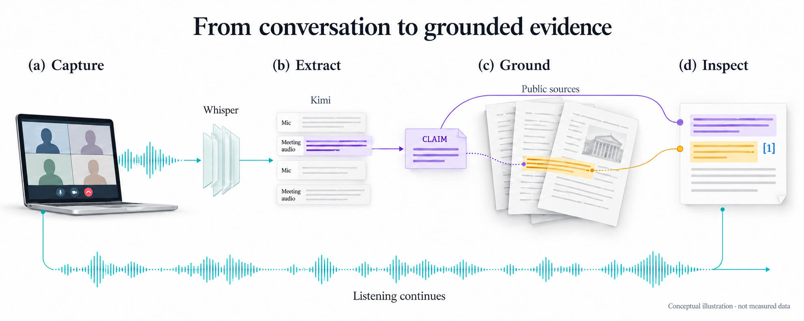

**Information changes form; listening does not wait for research.** Whisper produces
transcript segments, Kimi extracts claims, Firecrawl retrieves source material, and
Kimi synthesizes a finding that the server validates. Microphone and meeting audio
are channels, not identified speakers. See the [system guide](SYSTEM_GUIDE.md).

## 2. Why can't a late answer overwrite newer work?

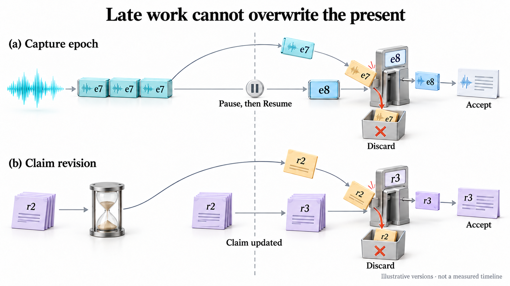

**Old work remains old.** Successful Pause drains accepted audio before advancing
the capture epoch; Resume admits fresh audio. A failed drain preserves the old
epoch for explicit recovery. The simplified drawing shows the successful
generation-change case, not a policy of discarding retained audio. A changed claim
advances its research revision. Neither obsolete result is
published. The drawing omits additional session/state checks for clarity; the
[research pipeline](RESEARCH_PIPELINE.md) specifies them. Packet positions are not
measured times.

## 3. What survives a failed save?

**Related relational rows commit together, or the transaction rolls back.**
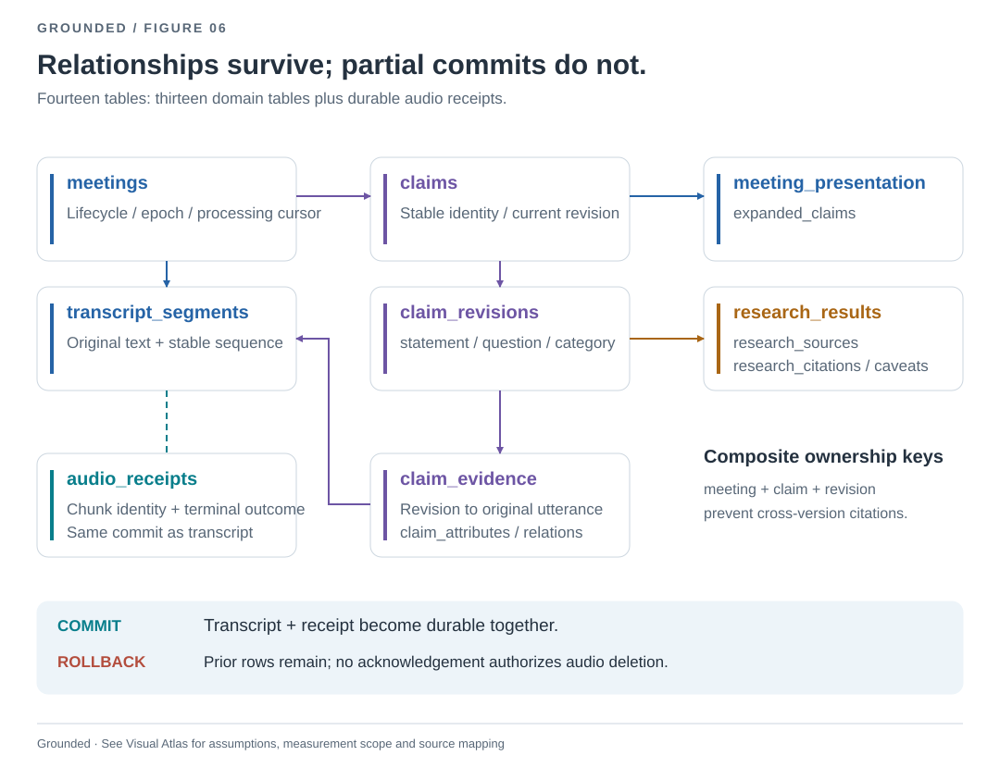

The map groups child tables to emphasize ownership; it does not draw every foreign
key. See the authoritative
[normalized schema](HISTORY_SCHEMA.md) and [durable audio protocol](DURABLE_AUDIO.md).
Reopening restores saved results without capture; explicit recovery can resume
incomplete processing.

## Technical reference

These deliberately denser diagrams answer implementation questions, not replace
the primary visual explanation. Each SVG can be opened at full size.

### Execution ownership
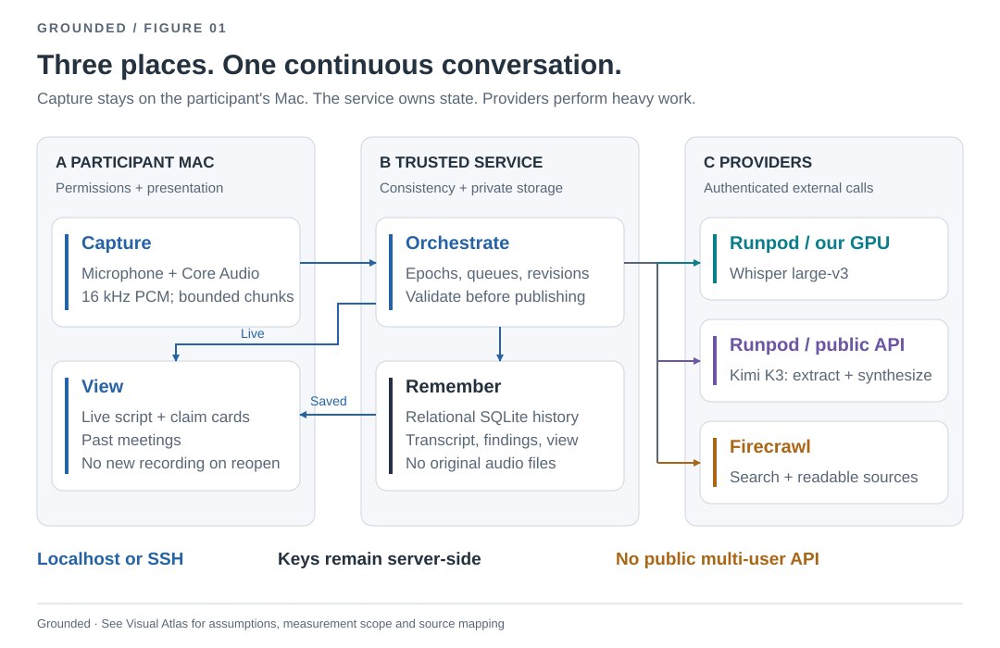

### Provenance, not just a citation badge
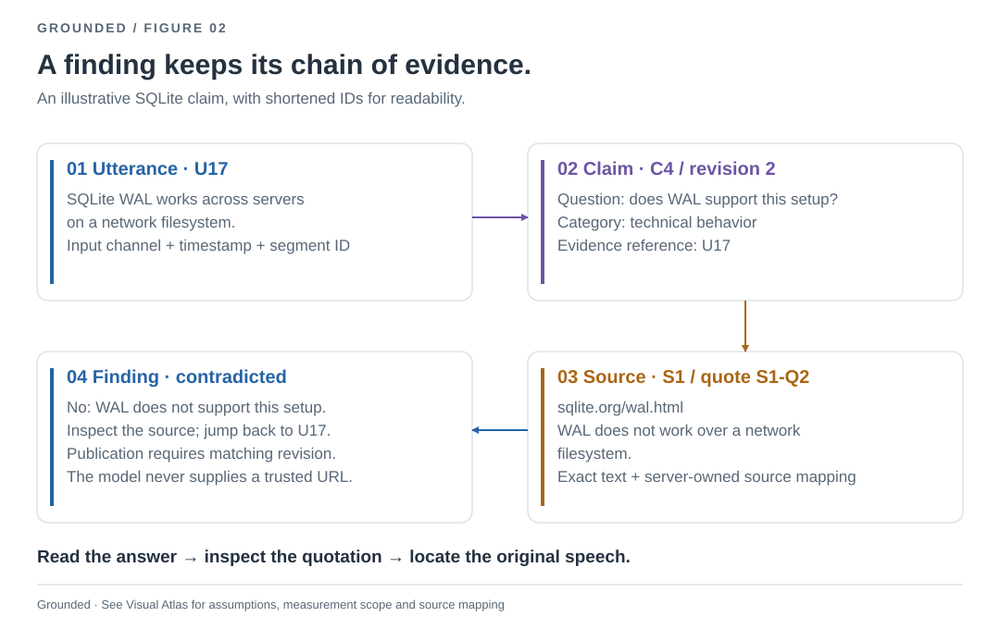

Identifiers are illustrative. Exact-quote validation proves provenance, not truth.

### Concurrent listening and checking
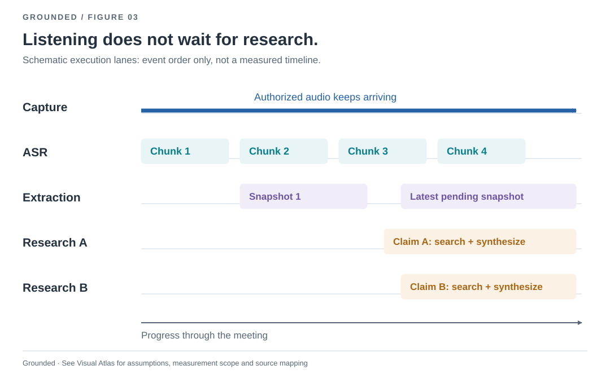

Schematic scheduling, not a trace or proportional timing measurement.

### Version checks and session lifecycle
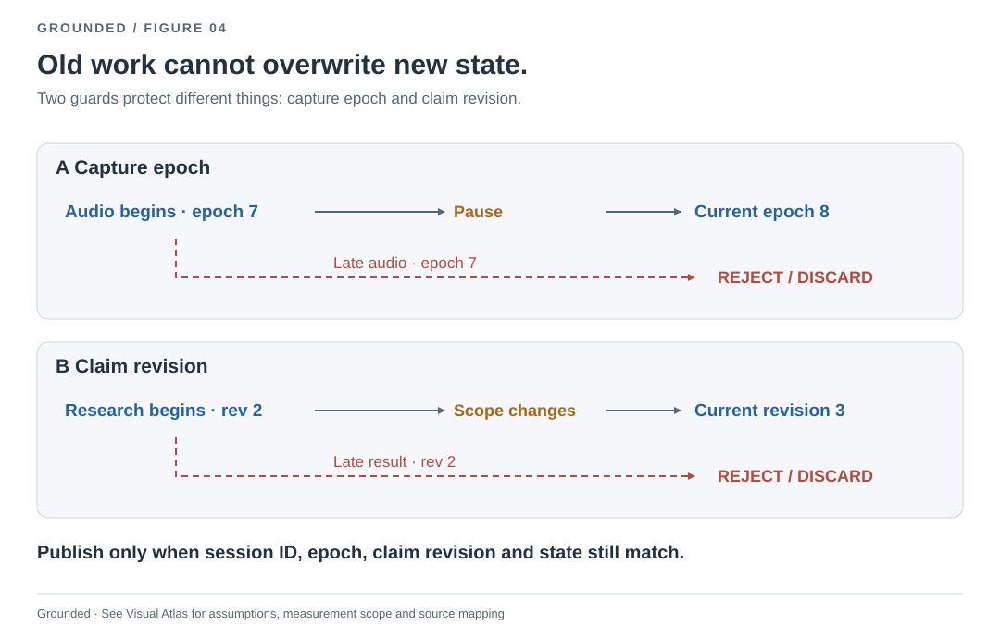
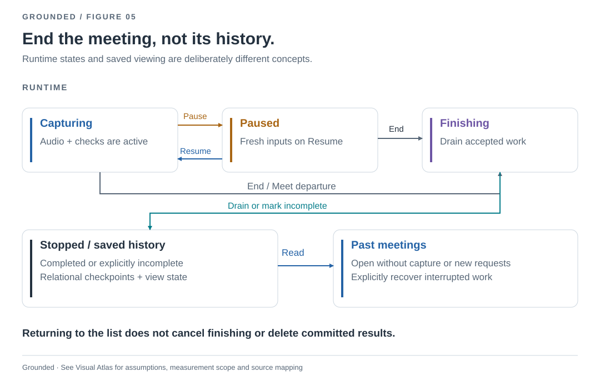

### Persistence schema and validation boundaries
See [the relational schema](HISTORY_SCHEMA.md) for exact keys and constraints.
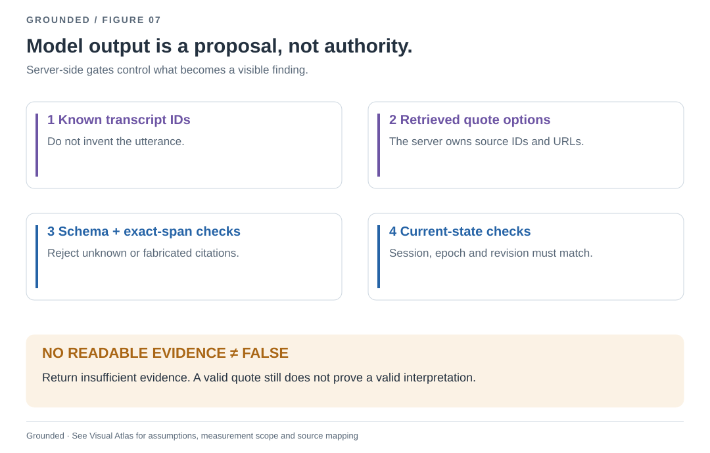

### Failure recovery
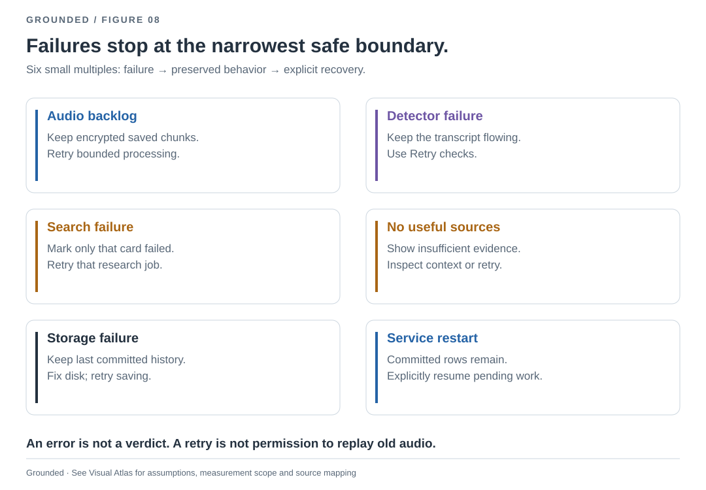

### Where the measured research time went
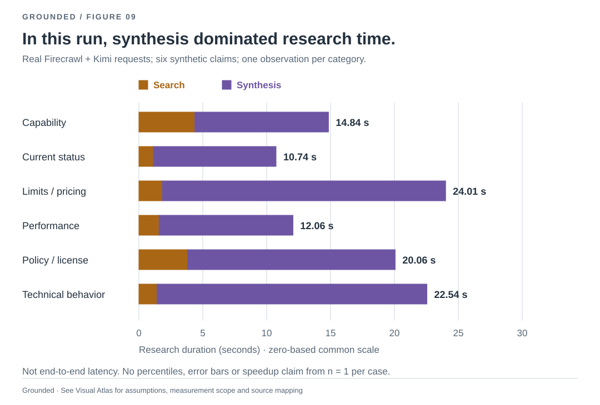

One observation per category with synthetic claims and real providers; research
concurrency was three for this evaluation, not the product's two-worker setting.
Capture, ASR, extraction and UI delivery are excluded. Validation is included in
totals but too small to show as a meaningful bar. No percentiles or SLA are implied.
See [measurement data](figures/measurements.json) and [validation](VALIDATION.md).

### What the evidence establishes—and does not
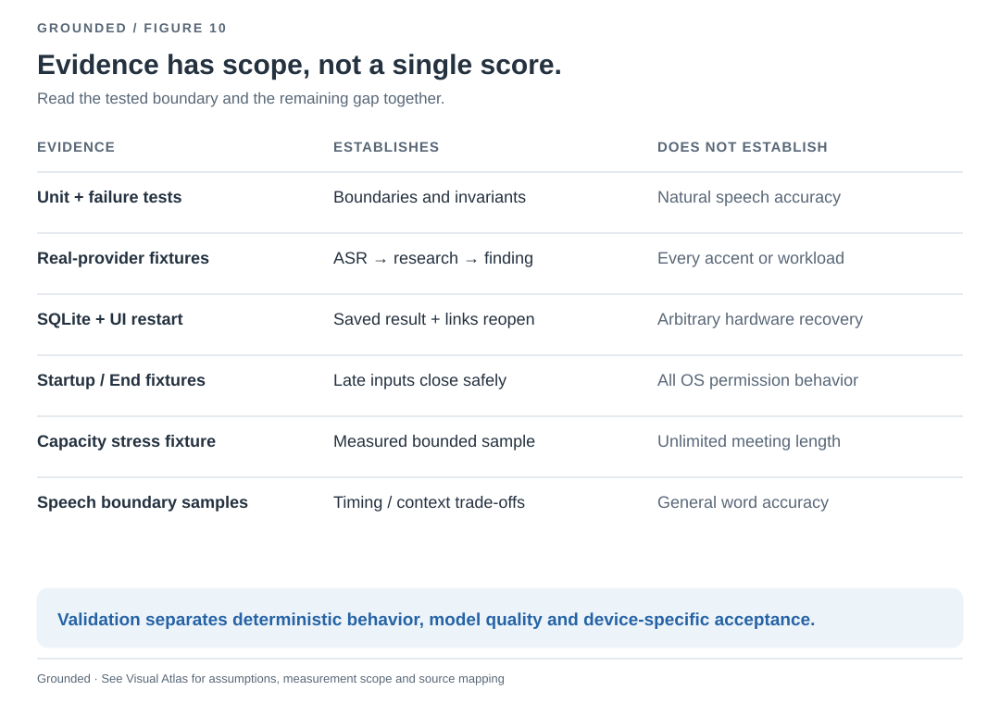

Counts describe the recorded milestone, not universal accuracy or the current
number of tests after documentation-only additions.

## Design sources and maintenance

Run `uv run python -m scripts.build_figures` to regenerate
technical SVGs and the [local gallery](figures/index.html). The two conceptual
PNGs are AI-generated conceptual illustrations, not runtime screenshots or outputs
of the deterministic generator. Technical SVGs and their source code provide the
precise implementation-level reference.
